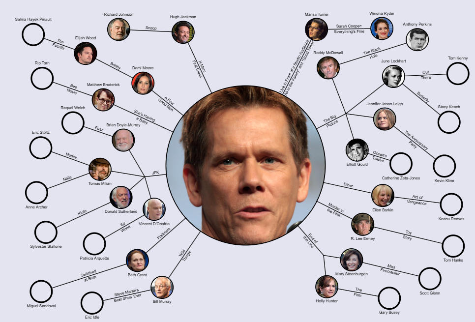

# Introducción

Este tutorial es la segunda parte de un análisis detallado de redes aplicado a la biología. En el primer tutorial, exploramos propiedades básicas como el grado (degree), el coeficiente de clustering y algunas métricas de intermediación (betweenness). Estas propiedades nos brindan una comprensión inicial de cómo los nodos y las conexiones en una red contribuyen a su estructura y funcionalidad general.

En esta segunda parte, profundizaremos en métricas avanzadas que describen aspectos estructurales y dinámicos de redes biológicas complejas, como la modularidad, densidad de aristas (edge density), dispersión (sparsity), asortatividad (assortativity), diámetro de la red (network diameter) y longitud promedio de los caminos (average path length). Con ejemplos prácticos en biología y fragmentos de código en R, este tutorial facilita la comprensión de cómo estas propiedades se pueden aplicar para analizar sistemas biológicos, como redes de proteínas y metabolitos, y su resiliencia ante cambios como mutaciones o intervenciones farmacológicas.

# Modularidad

La **modularidad** es una medida clave en el análisis de redes, particularmente útil para identificar comunidades o módulos dentro de una red, es decir, grupos de nodos que están densamente conectados entre sí, pero relativamente poco conectados con otros nodos fuera del grupo. Este concepto es valioso en biología porque muchos sistemas biológicos, como las redes de interacción proteína-proteína (PPI, *Protein-Protein Interaction*), tienden a organizarse en módulos funcionales. Por ejemplo, en una red de proteínas, las proteínas que funcionan en el mismo proceso biológico tienden a formar módulos o comunidades.

## ¿Cómo se calcula la modularidad?

La modularidad $Q$ se calcula para evaluar si una red tiene una estructura modular significativa. La ecuación básica para la modularidad de una red es:

$$
Q = \frac{1}{2m} \sum_{i,j} \left( A_{ij} - \frac{k_i k_j}{2m} \right) \delta(c_i, c_j)
$$

Donde:

-   $Q$ es el valor de modularidad.
-   $m$ es el número total de aristas en la red (lo que en la parte I llamamos $E$).
-   $A_{ij}$ representa la entrada en la posición $(i, j)$ de la matriz de adyacencia de la red, donde $A_{ij} = 1$ si hay una arista entre los nodos $i$ y $j$, y $A_{ij} = 0$ si no la hay.
-   $k_i$ es el grado del nodo $i$ (es decir, el número de conexiones que tiene el nodo $i$).
-   $\delta(c_i, c_j)$ es una función indicadora que es igual a 1 si los nodos $i$ y $j$ pertenecen a la misma comunidad y 0 en caso contrario.

Esta ecuación compara la densidad de enlaces dentro de las comunidades con la densidad esperada de enlaces si las conexiones fueran aleatorias, es decir, si la red se hubiera generado de forma aleatoria manteniendo el mismo grado de cada nodo.

### Pasos detallados para calcular la modularidad

1.  **Identificar la estructura de la comunidad**: La red se divide en comunidades o módulos (grupos de nodos densamente conectados entre sí). Esto puede hacerse con algoritmos específicos como el algoritmo de Louvain o el algoritmo de agrupamiento *fast-greedy*, que buscan maximizar la modularidad $Q$ dividiendo la red en comunidades. Veremos más algoritmos de clusterización en la siguiente parte teórica.

2.  **Calcular la matriz de adyacencia y el grado**: A partir de la estructura de la red, construimos la matriz de adyacencia $A$ y calculamos el grado de cada nodo $k_i$.

3.  **Sumar las diferencias entre enlaces observados y esperados**: Para cada par de nodos $i$ y $j$, se calcula $A_{ij} - \frac{k_i k_j}{2m}$. El término $\frac{k_i k_j}{2m}$ es el número de aristas que *esperaríamos* entre $i$ y $j$ si la red fuera aleatoria con los mismos grados: dos nodos con grado alto tienen más probabilidad de estar conectados simplemente por azar. Así, el término controla por el grado de los nodos $i$ y $j$.

4.  **Sumar los valores para los pares dentro de la misma comunidad**: Los valores obtenidos en el paso anterior se suman únicamente para los pares de nodos $(i, j)$ que están dentro de la misma comunidad (esto lo controla la función $\delta(c_i, c_j)$).

5.  **Normalizar por el número total de enlaces**: Finalmente, el resultado se multiplica por $\frac{1}{2m}$ para obtener el valor final de modularidad $Q$.

Un valor de $Q$ alto indica una fuerte estructura modular, lo que significa que los nodos están agrupados en comunidades bien definidas. En cambio, un valor bajo o cercano a cero sugiere que los enlaces dentro y entre comunidades no difieren mucho de lo que se esperaría en una red aleatoria.

En la práctica, $Q$ nunca llega a 1 (con $c$ comunidades del mismo tamaño, el máximo es $1 - 1/c$), y en redes reales con comunidades claras suele estar entre 0.3 y 0.7.

### Una forma equivalente (y más fácil de calcular a mano)

Agrupando los términos por comunidad, la ecuación anterior se puede reescribir como:

$$
Q = \sum_{c} \left[ \frac{L_c}{m} - \left( \frac{d_c}{2m} \right)^2 \right]
$$

donde $L_c$ es el número de aristas *dentro* de la comunidad $c$ y $d_c$ es la suma de los grados de los nodos de la comunidad $c$. El primer término es la fracción de aristas que caen dentro de la comunidad; el segundo, la fracción que esperaríamos por azar.

**Ejemplo a mano**: dos triángulos unidos por una sola arista ($m = 7$). Si cada triángulo es una comunidad, cada una tiene $L_c = 3$ aristas internas y $d_c = 2 + 2 + 3 = 7$, así que:

$$
Q = 2 \times \left[ \frac{3}{7} - \left( \frac{7}{14} \right)^2 \right] = 2 \times (0.429 - 0.25) = 0.357
$$

```{r}
#| message: false
library(igraph)
g_triangulos <- make_graph(~ 1-2, 2-3, 3-1, 4-5, 5-6, 6-4, 3-4)
plot(g_triangulos, vertex.color = c(1, 1, 1, 2, 2, 2))

# Modularidad para la partición {1,2,3} y {4,5,6}
modularity(g_triangulos, membership = c(1, 1, 1, 2, 2, 2))

# ¿Y si dividimos la red "mal"? La modularidad baja (incluso puede ser negativa)
modularity(g_triangulos, membership = c(1, 2, 1, 2, 1, 2))
```

La modularidad no es solo una propiedad de la red, sino de la red **y** de una partición en comunidades. Los algoritmos de detección de comunidades (Louvain, fast-greedy...) buscan la partición que da la $Q$ más alta.

## Ejemplo Biológico de Modularidad

En redes de interacción proteína-proteína, la modularidad puede identificar comunidades que corresponden a complejos proteicos funcionales o a proteínas que participan en la misma ruta metabólica. Por ejemplo, en una red de proteínas involucradas en la respuesta inmune, los módulos de alta modularidad pueden corresponder a diferentes mecanismos inmunitarios, como la respuesta inflamatoria o la activación de células T.

## Código en R para Calcular Modularidad

El siguiente código crea dos redes con **el mismo número de nodos y de aristas**: una con comunidades claramente definidas y otra aleatoria. Así, cualquier diferencia en la modularidad se debe a *cómo* están distribuidas las aristas, y no a cuántas hay.

```{r}
set.seed(42)

# Red con alta modularidad: 4 "islas" de 10 nodos, con probabilidad 0.8 de
# conexión dentro de cada isla y solo 3 aristas entre cada par de islas
high_modularity_network <- sample_islands(4, 10, 0.8, 3)

# Red aleatoria con los mismos nodos y aristas
low_modularity_network <- sample_gnm(40, ecount(high_modularity_network))

# Detectamos comunidades UNA sola vez por red (Louvain tiene un componente
# aleatorio: si lo llamamos dos veces, puede dar particiones distintas)
com_high <- cluster_louvain(high_modularity_network)
com_low  <- cluster_louvain(low_modularity_network)

cat("Aristas:", ecount(high_modularity_network), "vs", ecount(low_modularity_network), "\n")
cat("Modularidad de la red modular:  ", round(modularity(com_high), 3), "con", length(com_high), "comunidades\n")
cat("Modularidad de la red aleatoria:", round(modularity(com_low), 3), "con", length(com_low), "comunidades\n")

par(mfrow = c(1, 2), mar = c(1, 1, 2, 1))
plot(high_modularity_network, vertex.color = membership(com_high), vertex.size = 8, vertex.label = NA,
     main = paste("Red modular, Q =", round(modularity(com_high), 2)))
plot(low_modularity_network, vertex.color = membership(com_low), vertex.size = 8, vertex.label = NA,
     main = paste("Red aleatoria, Q =", round(modularity(com_low), 2)))
par(mfrow = c(1, 1))
```

### Interpretación de los Resultados

-   La **red modular** tiene cuatro comunidades con muchas conexiones internas y muy pocas entre ellas. Louvain recupera exactamente las cuatro islas, y $Q$ es alta (cerca del máximo teórico de $1 - 1/4 = 0.75$).

-   La **red aleatoria** no tiene comunidades "reales" y, sin embargo, ¡Louvain encuentra comunidades y $Q$ no es cero! Esto ocurre porque el algoritmo *busca* la partición que maximiza $Q$, y por puro azar siempre hay grupos de nodos algo más conectados entre sí. Es un efecto especialmente fuerte en redes pequeñas y poco densas (con `sample_gnp(40, p = 0.1)` se obtiene $Q \approx 0.4$).

::: callout-important
## ¿Cuándo es "alta" una modularidad?

Un valor de $Q$ por sí solo no dice mucho: hay que compararlo con el que se obtiene en redes aleatorias **del mismo tamaño y densidad**. Si la $Q$ de nuestra red biológica es mucho mayor que la de las redes aleatorias equivalentes, entonces sí podemos decir que tiene estructura modular.
:::

```{r}
# Distribución de Q en 100 redes aleatorias equivalentes
q_random <- replicate(100, modularity(cluster_louvain(sample_gnm(40, ecount(high_modularity_network)))))

hist(q_random, xlim = c(0, 0.8), col = "grey80", main = "Q en redes aleatorias equivalentes",
     xlab = "Modularidad Q")
abline(v = modularity(com_high), col = "red", lwd = 3)
```

La línea roja (la red modular) queda muy lejos de la distribución de las redes aleatorias: su estructura modular no se puede explicar por azar.

# Densidad de Aristas (Edge Density) y Dispersión (Sparsity)

La **densidad de aristas** y la **dispersión** son métricas que reflejan cuán conectada está una red en relación con lo que *podría* estar.

## **Densidad de Aristas (Edge Density)**

La densidad indica cuántas interacciones existen en relación con el total de interacciones posibles. En una red no dirigida con $N$ nodos hay $\frac{N(N-1)}{2}$ pares de nodos posibles, así que la densidad ($D$) se calcula como:

$$
D = \frac{m}{N(N-1)/2} = \frac{2m}{N(N-1)}
$$

Donde:

-   $D$ es la densidad (entre 0 y 1),
-   $m$ es el número de aristas presentes en la red,
-   $N$ es el número de nodos.

Una densidad de 1 corresponde a un grafo completo (todos los nodos conectados con todos); una densidad cercana a 0, a una red con muy pocas conexiones.

### Ejemplos biológicos

-   **Complejos proteicos (densos)**: en un complejo como el proteasoma o el complejo del poro nuclear, muchas subunidades interaccionan físicamente entre sí. Si representamos solo las proteínas del complejo, la subred es muy densa ($D$ cercana a 1).
-   **Cascadas de señalización lineales (dispersas)**: el módulo central de la vía MAPK (Raf → MEK → ERK) es el ejemplo clásico de cascada lineal: cada quinasa activa a la siguiente. Una cadena de $N$ proteínas tiene solo $N-1$ aristas, así que su densidad es $D = 2/N$, muy baja si la cadena es larga. (En la célula real, estas vías tienen además bucles de retroalimentación, proteínas andamio y conexiones con otras vías, que aumentan la densidad.)
-   **El interactoma humano completo (muy disperso)**: con unas 20.000 proteínas y unas 650.000 interacciones estimadas (ver parte I), la densidad es $D = \frac{2 \times 650000}{20000 \times 19999} \approx 0.003$. Es decir, ¡solo el 0.3% de las interacciones posibles existen! Prácticamente todas las redes biológicas grandes son muy dispersas.

### Cuidado: la densidad depende del tamaño de la red

Usando que el grado medio es $\langle k \rangle = 2m/N$ (parte I), la densidad se puede escribir como:

$$
D = \frac{\langle k \rangle}{N-1}
$$

Si cada proteína tiene, de media, el mismo número de interacciones, la densidad **disminuye** a medida que la red crece. Por eso no tiene mucho sentido comparar la densidad de redes de tamaños muy distintos: una red pequeña casi siempre parecerá "más densa". Para comparar redes de distinto tamaño suele ser más útil el grado medio.

## **Dispersión (Sparsity)**

La dispersión es simplemente el complemento de la densidad:

$$
\text{Dispersión} = 1 - D
$$

Una red con alta dispersión tiene muy pocas de las conexiones posibles. En redes de señalización, una arquitectura dispersa favorece interacciones **específicas**: la señal sigue rutas concretas y se evitan activaciones erróneas de otras vías. Una arquitectura más densa aporta **redundancia**: si una conexión falla, hay rutas alternativas para la señal.

## **Cálculo de Densidad y Dispersión en R**

```{r}
set.seed(1)

# Una red dispersa (cada nodo conectado con ~10% de los demás) y una densa (~50%)
sparse_network <- sample_gnp(30, p = 0.1, directed = FALSE)
dense_network  <- sample_gnp(30, p = 0.5, directed = FALSE)

# Densidad y dispersión
sparse_density <- edge_density(sparse_network)
dense_density  <- edge_density(dense_network)

cat("Red dispersa: densidad =", round(sparse_density, 3), " dispersión =", round(1 - sparse_density, 3), "\n")
cat("Red densa:    densidad =", round(dense_density, 3), " dispersión =", round(1 - dense_density, 3), "\n")

# Comprobamos la fórmula a mano para la red dispersa
2 * ecount(sparse_network) / (vcount(sparse_network) * (vcount(sparse_network) - 1))

par(mfrow = c(1, 2), mar = c(1, 1, 2, 1))
plot(sparse_network, main = "Red Dispersa (especificidad)", vertex.size = 8, vertex.label = NA)
plot(dense_network,  main = "Red Densa (redundancia)", vertex.size = 8, vertex.label = NA)
par(mfrow = c(1, 1))
```

Ahora comprobamos que, con el mismo grado medio, la densidad cae al aumentar el tamaño de la red:

```{r}
tamanos <- c(50, 100, 500, 1000, 5000)

# Redes aleatorias con grado medio 4 (m = 2N aristas) y distinto número de nodos
densidades <- sapply(tamanos, function(N) edge_density(sample_gnm(N, 2 * N)))

data.frame(nodos = tamanos, grado_medio = 4, densidad = round(densidades, 4))
```

## **Aplicaciones de Densidad y Dispersión**

1.  **Redes de Señalización Celular Complejas**: en sistemas como la señalización en células inmunitarias, una mayor densidad (más rutas alternativas y retroalimentación) puede ser ventajosa para asegurar respuestas rápidas y robustas, como en la activación de linfocitos T ante una infección. Una mayor dispersión es útil cuando se necesita especificidad, como en la señalización por citocinas, donde cada citocina debe activar solo a las células con el receptor adecuado.

2.  **Diseño de Fármacos Basado en la Estructura de la Red**: en una zona densa de la red, inhibir una sola proteína puede tener poco efecto, porque la señal encuentra rutas alternativas (redundancia); a menudo se necesitan combinaciones de fármacos. En una zona dispersa, como una cascada lineal, inhibir un solo punto puede bloquear toda la señal aguas abajo (por ejemplo, los inhibidores de MEK o de BRAF en melanoma), aunque la célula puede acabar "reconectando" la señal por otras vías y generar resistencia.

# Longitudes Promedio de Camino en Redes

## **Entendiendo la Longitud Promedio de Camino**

La **distancia** $d(i,j)$ entre dos nodos es el número de aristas del camino más corto que los une. La **longitud promedio de camino** es la media de esas distancias sobre todos los pares de nodos de la red: nos dice cuántos "pasos" hay que dar, típicamente, para ir de un nodo a otro.

Matemáticamente, para un grafo no dirigido con $N$ nodos:

$$
L_{avg} = \frac{1}{N(N-1)} \sum_{i \neq j} d(i,j)
$$

En redes que no son conexas, $d(i,j)$ es infinita para nodos en componentes distintas. `mean_distance()` de igraph simplemente ignora esos pares (por defecto, `unconnected = TRUE`).

```{r}
# Ejemplo pequeño: una cadena de 5 nodos (como una cascada de señalización lineal)
cadena <- make_ring(5, circular = FALSE)
plot(cadena)

# Matriz de distancias: el elemento [i, j] es d(i, j)
distances(cadena)

# La media de las distancias fuera de la diagonal es L_avg
mean_distance(cadena)
```

En la cadena, ir del nodo 1 al 5 requiere 4 pasos. Si añadimos una sola arista "atajo" entre 1 y 5, la red se convierte en un anillo y la distancia media baja. Este efecto de los atajos es la clave de las redes de pequeño mundo.

## Redes de Pequeño Mundo (Small-World)

Watts y Strogatz (*Nature*, 1998) describieron que muchas redes reales combinan dos propiedades que parecían incompatibles:

1.  **Longitud promedio de camino corta**, como en una red aleatoria: cualquier par de nodos está a pocos pasos.
2.  **Coeficiente de clustering alto**, como en una red regular (retícula): los vecinos de un nodo suelen estar conectados entre sí.

Las redes que cumplen ambas se llaman de **pequeño mundo**. Su modelo parte de un anillo regular (cada nodo conectado a sus vecinos más cercanos: clustering alto, caminos largos) y "reconecta" cada arista al azar con probabilidad $p$. Con solo unos pocos atajos, la longitud de camino cae en picado, mientras que el clustering disminuye mucho más despacio:

```{r}
set.seed(1)
N <- 100

p_values <- c(0, 0.01, 0.05, 0.2, 1)
redes_ws <- lapply(p_values, function(p) sample_smallworld(dim = 1, size = N, nei = 2, p = p))

data.frame(
  p_reconexion  = p_values,
  aristas       = sapply(redes_ws, ecount),
  L_avg         = round(sapply(redes_ws, mean_distance), 2),
  clustering    = round(sapply(redes_ws, transitivity, type = "average"), 2)
)

par(mfrow = c(1, 3), mar = c(1, 1, 3, 1))
for (i in c(1, 3, 5)) {
  plot(redes_ws[[i]], layout = layout_in_circle, vertex.size = 3, vertex.label = NA,
       main = paste0("p = ", p_values[i], "\nL = ", round(mean_distance(redes_ws[[i]]), 1),
                     ", C = ", round(transitivity(redes_ws[[i]], type = "average"), 2)))
}
par(mfrow = c(1, 1))
```

-   Con $p = 0$ (retícula regular): clustering alto pero caminos largos.
-   Con $p \approx 0.05$ (**pequeño mundo**): unos pocos atajos reducen la longitud de camino a casi un tercio, pero el clustering sigue siendo alto (mucho mayor que en la red aleatoria).
-   Con $p = 1$ (prácticamente aleatoria): caminos cortos pero clustering muy bajo.

### Valores reales (Watts & Strogatz, 1998)

| Red | $L_{avg}$ real | $L_{avg}$ aleatoria equivalente | $C$ real | $C$ aleatoria equivalente |
|---|---|---|---|---|
| Red neuronal de *C. elegans* (282 neuronas) | 2.65 | 2.25 | 0.28 | 0.05 |
| Actores de cine | 3.65 | 2.99 | 0.79 | 0.00027 |
| Red eléctrica del oeste de EE.UU. | 18.7 | 12.4 | 0.08 | 0.005 |

En las tres, la longitud de camino es parecida a la de una red aleatoria con los mismos nodos y aristas, pero el clustering es mucho mayor: son redes de pequeño mundo. Fíjate en que lo importante es la comparación con la red aleatoria equivalente, no el valor absoluto: la red eléctrica tiene $L_{avg} \approx 19$ porque es una red grande y extendida geográficamente.

### Ejemplos en Biología

-   **Redes de Interacción Proteína-Proteína (PPI)**: las proteínas son los nodos y las interacciones son las aristas. En las PPI, la longitud promedio de camino es corta (unos pocos pasos entre cualquier par de proteínas), en buena parte gracias a los hubs. Esto implica que una perturbación en una proteína puede propagarse rápidamente a muchas otras.
-   **Redes metabólicas**: Jeong *et al.* (*Nature*, 2000) analizaron las redes metabólicas de 43 organismos y encontraron que la distancia media entre metabolitos es de unos 3 pasos, y prácticamente la misma en todos, desde bacterias hasta eucariotas, a pesar de las grandes diferencias de tamaño.
-   **Redes tróficas**: aunque las especies se agrupen en grupos funcionales, la mayoría de las especies de una red trófica están a solo 2–3 enlaces de distancia ("dos grados de separación", Williams *et al.*, *PNAS* 2002).
-   **Redes cerebrales**: las redes de conectividad cerebral son a la vez **modulares** (regiones especializadas en distintas funciones) y de **pequeño mundo** (pocas conexiones de larga distancia, a menudo a través de hubs, unen los módulos). Esta combinación permite el procesamiento especializado dentro de cada módulo y una integración rápida de la información entre módulos.

### **Ejemplo Fuera de la Biología: Redes Sociales**

En las redes sociales, donde las personas son los nodos y las relaciones sociales son las aristas, las longitudes promedio de camino son cortas. En el famoso experimento de Stanley Milgram (1967), cartas enviadas a un desconocido a través de cadenas de conocidos llegaron a su destino en unos 6 pasos de media: los famosos "seis grados de separación".

## Redes con Longitudes Promedio de Camino Largas

Las longitudes de camino largas aparecen cuando la red **no tiene atajos**:

-   **Redes espaciales o de tipo retícula**: la red eléctrica o la red de carreteras, donde los nodos solo se conectan con otros cercanos en el espacio. Para cruzar la red hay que pasar por muchos nodos intermedios.
-   **Cadenas y cascadas lineales**: en una ruta metabólica lineal o una cascada de señalización sin ramificaciones, la distancia entre los extremos crece con el número de pasos.
-   **Redes muy modulares con pocas conexiones entre módulos**: dentro de cada módulo las distancias son cortas, pero para ir de un módulo a otro hay que pasar por las pocas aristas que los unen. Ojo: modularidad y pequeño mundo **no son excluyentes** (el cerebro es ambas cosas); los caminos solo se alargan si los módulos están conectados por muy pocas aristas.

En general, una longitud de camino corta sugiere un sistema en el que la información (o una perturbación) se propaga rápidamente, y una longitud larga, un sistema más "lento" o segregado.

## Diámetro (Diameter)

El **diámetro de una red** es la mayor de todas las distancias entre pares de nodos. Es decir, de todos los caminos más cortos posibles, el diámetro es la longitud del más largo. Mientras la longitud promedio de camino describe la distancia *típica*, el diámetro describe el *peor caso*: cuán "extendida" o "compacta" es la red.

$$
\text{diam}(G) = \max_{i \neq j} d(i,j)
$$

donde $d(i,j)$ es la distancia (camino más corto) entre los nodos $i$ y $j$.

### **Relación entre Longitud Promedio de Camino y Diámetro**

-   **Redes de Pequeño Mundo**: el diámetro suele ser pequeño, porque los atajos acercan incluso a los nodos más alejados.
-   **Redes tipo retícula o espaciales**: el diámetro es grande, ya que para unir los extremos de la red hay que recorrer muchos nodos intermedios.

{width="80%"}

### Cálculo del Diámetro en R

```{r}
set.seed(2)

# Red de escala libre (Barabási-Albert, no dirigida): pocos pasos gracias a los hubs
red_ba <- sample_pa(100, m = 2, directed = FALSE)

# Red casi regular (Watts-Strogatz con p muy baja): prácticamente un anillo, sin atajos
red_reticula <- sample_smallworld(dim = 1, size = 100, nei = 2, p = 0.01)

data.frame(
  red      = c("Barabási-Albert", "Casi retícula"),
  aristas  = c(ecount(red_ba), ecount(red_reticula)),
  L_avg    = round(c(mean_distance(red_ba), mean_distance(red_reticula)), 2),
  diametro = c(diameter(red_ba), diameter(red_reticula))
)

# El camino más largo de todos (el que define el diámetro)
camino_ba  <- get_diameter(red_ba)
camino_ret <- get_diameter(red_reticula)

par(mfrow = c(1, 2), mar = c(1, 1, 3, 1))
plot(red_ba, vertex.size = 4, vertex.label = NA,
     vertex.color = ifelse(V(red_ba) %in% camino_ba, "red", "grey80"),
     main = paste("Barabási-Albert\nDiámetro:", diameter(red_ba)))
plot(red_reticula, layout = layout_in_circle, vertex.size = 4, vertex.label = NA,
     vertex.color = ifelse(V(red_reticula) %in% camino_ret, "red", "grey80"),
     main = paste("Casi retícula\nDiámetro:", diameter(red_reticula)))
par(mfrow = c(1, 1))
```

Con prácticamente el mismo número de aristas, la red de escala libre tiene un diámetro mucho menor: los hubs actúan como atajos. En rojo se muestra el camino más corto más largo de cada red.

# Asortatividad de Grado (Degree Assortativity)

### **Definición**

La **asortatividad de grado** mide la tendencia de los nodos a conectarse con otros nodos de grado similar:

-   **Asortatividad positiva** ($r > 0$): los hubs se conectan con otros hubs, y los nodos poco conectados con otros nodos poco conectados.
-   **Asortatividad negativa o disasortatividad** ($r < 0$): los hubs se conectan preferentemente con nodos de grado bajo (y no entre sí).
-   **Sin asortatividad** ($r \approx 0$): el grado de un nodo no dice nada sobre el grado de sus vecinos, como en una red aleatoria.

### **Ecuación para la Asortatividad**

La forma más intuitiva de definirla: tomamos cada arista de la red y anotamos el grado de los dos nodos que une. El coeficiente de asortatividad $r$ es simplemente la **correlación de Pearson** entre los grados de los dos extremos de las aristas, y por tanto va de $-1$ a $1$.

Escrita con la matriz de adyacencia (Newman, 2002), tiene una forma muy parecida a la de la modularidad:

$$
r = \frac{\sum_{ij} \left(A_{ij} - \frac{k_i k_j}{2m}\right) k_i k_j}{\sum_{ij} \left(k_i \delta_{ij} - \frac{k_i k_j}{2m}\right) k_i k_j}
$$

donde $\delta_{ij} = 1$ si $i = j$ y 0 en caso contrario. El numerador compara, igual que en la modularidad, las aristas observadas ($A_{ij}$) con las esperadas por azar ($\frac{k_i k_j}{2m}$), pero ahora ponderadas por el producto de los grados; el denominador normaliza para que $r$ esté entre $-1$ y $1$.

### **Ejemplos en R**

Construimos tres redes pequeñas con asortatividad positiva, nula y negativa:

```{r}
set.seed(123)

# 1. Asortativa: un grupo de 10 nodos todos conectados entre sí (grado alto)
#    unido por UNA arista a un anillo de 20 nodos (grado 2).
#    Los nodos de grado alto se conectan con nodos de grado alto, y los de grado bajo entre sí.
g_asort <- disjoint_union(make_full_graph(10), make_ring(20))
g_asort <- add_edges(g_asort, c(1, 11))

# 2. Neutra: red aleatoria Erdős–Rényi (algo más grande, para que r fluctúe menos)
g_neutra <- sample_gnp(100, p = 0.05)

# 3. Disasortativa: 3 "estrellas" (un hub conectado a 9 nodos de grado 1),
#    con los hubs unidos entre sí. Los hubs se conectan sobre todo con nodos de grado bajo.
g_disasort <- disjoint_union(make_star(10, mode = "undirected"),
                             make_star(10, mode = "undirected"),
                             make_star(10, mode = "undirected"))
g_disasort <- add_edges(g_disasort, c(1, 11, 11, 21, 21, 1))

redes <- list(Asortativa = g_asort, Neutra = g_neutra, Disasortativa = g_disasort)
sapply(redes, function(g) round(assortativity_degree(g), 2))

par(mfrow = c(1, 3), mar = c(1, 1, 3, 1))
for (nombre in names(redes)) {
  g <- redes[[nombre]]
  plot(g, vertex.size = 3 + 0.6 * degree(g), vertex.label = NA,
       main = paste0(nombre, "\nr = ", round(assortativity_degree(g), 2)))
}
par(mfrow = c(1, 1))
```

El tamaño de cada nodo es proporcional a su grado. En la red asortativa los nodos grandes están juntos y los pequeños juntos; en la disasortativa cada nodo grande está rodeado de nodos pequeños.

En una red aleatoria concreta, $r$ no es exactamente 0: fluctúa por azar alrededor de 0, y más cuanto más pequeña es la red. Si generamos muchas redes aleatorias, la media sí es prácticamente 0:

```{r}
r_aleatorias <- replicate(200, assortativity_degree(sample_gnp(100, p = 0.05)))
c(media = round(mean(r_aleatorias), 3), desviacion = round(sd(r_aleatorias), 3))
```

Podemos comprobar que $r$ es la correlación entre los grados de los extremos de las aristas:

```{r}
g <- g_disasort
extremos <- ends(g, E(g), names = FALSE)   # matriz con los dos nodos de cada arista
k <- degree(g)

# Cada arista no dirigida se cuenta en los dos sentidos (i-j y j-i)
grado_1 <- c(k[extremos[, 1]], k[extremos[, 2]])
grado_2 <- c(k[extremos[, 2]], k[extremos[, 1]])

cor(grado_1, grado_2)
assortativity_degree(g)
```

## **Asortatividad en Redes Reales**

Newman (*Phys. Rev. Lett.*, 2002) observó un patrón muy llamativo: las **redes sociales** suelen ser asortativas, mientras que las **redes biológicas y tecnológicas** suelen ser disasortativas. Algunos valores aproximados:

| Red | Tipo | $r$ |
|---|---|---|
| Coautorías científicas (física) | Social | +0.36 |
| Actores de cine | Social | +0.21 |
| Internet | Tecnológica | −0.19 |
| Interacciones proteína-proteína (levadura) | Biológica | −0.16 |
| Red metabólica | Biológica | −0.24 |
| Red neuronal de *C. elegans* | Biológica | −0.23 |
| Red trófica marina | Biológica | −0.26 |

### **Asortatividad Positiva**

En redes con asortatividad positiva, los nodos con grados similares tienden a conectarse entre sí. Los nodos de grado alto forman un "núcleo" muy conectado, lo que hace la red más resistente a la eliminación de hubs (si cae uno, los demás siguen conectados entre sí), aunque también facilita que algo se propague rápidamente por ese núcleo (por ejemplo, una infección entre las personas más sociables).

-   **Redes Sociales**: en redes de coautoría o en redes como LinkedIn, las personas con muchas conexiones suelen estar vinculadas a otras personas con muchos contactos, lo que genera grupos densamente interconectados.
-   **Dentro de complejos proteicos**: aunque la red PPI en su conjunto es disasortativa, a escala local puede haber zonas asortativas. Por ejemplo, las proteínas ribosómicas tienen muchas interacciones y muchas de ellas son con otras proteínas ribosómicas, para garantizar el ensamblaje y la función del ribosoma.

### **Asortatividad Negativa**

En redes con asortatividad negativa, los nodos de alto grado tienden a conectarse con nodos de bajo grado, y los hubs evitan conectarse entre sí. Esto genera una estructura de "estrellas" relativamente independientes.

-   **Redes de Interacción Proteína-Proteína**: Maslov y Sneppen (*Science*, 2002) mostraron que, en la red PPI de levadura, los hubs tienden a *no* interactuar directamente entre sí. Una interpretación es que esto separa los distintos módulos funcionales (cada uno organizado alrededor de su hub) y reduce la propagación de perturbaciones de un módulo a otro.
-   **Redes de Regulación Génica**: unos pocos factores de transcripción maestros regulan a muchos genes diana, que a su vez regulan a pocos o ningún otro gen.
-   **Redes Metabólicas**: los metabolitos universales, como el ATP, actúan como hubs al conectar con muchos metabolitos específicos, cada uno de los cuales participa en pocas reacciones.
-   **Redes de Transporte**: en redes aéreas, los grandes aeropuertos internacionales (hubs) están conectados con muchos aeropuertos regionales más pequeños.

### **Comparación en Biología**

-   La **asortatividad positiva** genera un núcleo de nodos muy conectados entre sí, que refuerza la cohesión dentro de módulos funcionales, como complejos proteicos específicos.
-   La **asortatividad negativa**, la más habitual en redes biológicas, separa los hubs entre sí y ayuda a mantener los módulos funcionales relativamente aislados, limitando la propagación de fallos o perturbaciones por la red.

# Ejercicio

Aplicar conceptos de **modularidad**, **densidad de aristas**, **dispersión**, **longitud promedio de camino** y **asortatividad de grado** para analizar la estructura y funcionalidad de redes biológicas utilizando **R** y la librería **igraph**.

## Instrucciones

### Parte 1: Creación y visualización

1. Crea dos redes en R:
   - Una **red modular**, con comunidades internas densas (`sample_islands`).
   - Una **red aleatoria** con el **mismo número de nodos y aristas**, sin comunidades claras (`sample_gnm` y `ecount`).

2. Visualiza ambas redes y **describe las diferencias visuales**:
   - Conectividad
   - Agrupamiento
   - Presencia de comunidades

¿Qué diferencias visuales observas entre ambas redes en términos de conectividad y agrupamiento?


### Parte 2: Cálculo de Métricas Topológicas

Calcula las siguientes métricas para ambas redes:

| Propiedad                   | Función en R                       | Significado                               |
| --------------------------- | ---------------------------------- | ----------------------------------------- |
| Modularidad                 | `modularity(cluster_louvain(red))` | Evalúa la existencia de comunidades       |
| Densidad                    | `edge_density(red)`                | Proporción de conexiones existentes       |
| Dispersión                  | `1 - edge_density(red)`            | Proporción de conexiones ausentes         |
| Longitud promedio de camino | `mean_distance(red)`               | Eficiencia en la comunicación             |
| Diámetro                    | `diameter(red)`                    | Máxima distancia entre nodos              |
| Asortatividad               | `assortativity_degree(red)`        | Tendencia de nodos similares a conectarse |

Representa los resultados como una tabla (`data.frame`) para comparar valores entre redes.

### Parte 3: Interpretación

1. ¿Qué métricas son iguales en las dos redes? ¿Por qué? (Pista: piensa en cómo las has construido.)
2. ¿Qué métricas cambian más? Relaciona cada diferencia con lo que ves en los gráficos de la Parte 1.
3. ¿Es la modularidad de la red aleatoria igual a cero? ¿Por qué no?
4. Si la red modular fuera una red de proteínas, ¿qué podrían representar sus comunidades? ¿Qué proteínas elegirías como dianas para interrumpir la comunicación *entre* módulos?
